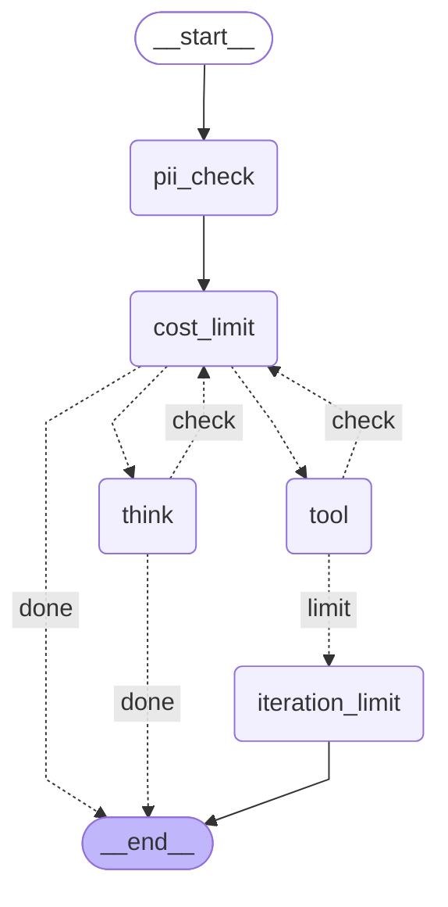

# Week 16 — BrightPath Agent Graph

The graph scrubs the user's question before the first model call. It checks the remaining budget before each outer model or tool call. The budget uses simulated units; actual API cost is unmeasured.

Verification: `tests/test_wk16_graph.py` — 4 passed. See `eval/logs/wk16-graph-guardrails.txt`.
